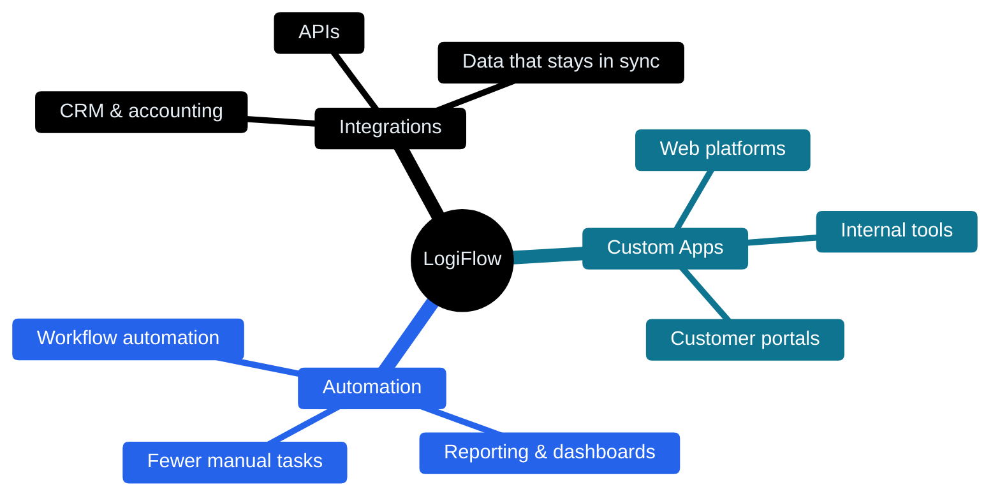
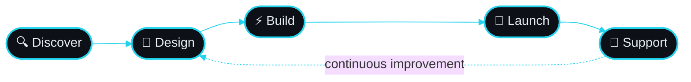

  
  <h1>Hi 👋, we're LogiFlow</h1>
  <h3>Custom Software &nbsp;|&nbsp; Workflow Automation &nbsp;|&nbsp; Integrations</h3>
 
  

 
<h2>🧩 What We Build</h2>
 

 
<h2>🧭 How We Work</h2>
 

 
 
<h2 align="center">Our Toolkit</h2>
 
<h3>🎨 Frontend:</h3>

 
<h3>⚙️ Backend:</h3>

 
<h3>🗄️ Databases:</h3>
&nbsp;
 
<h3>☁️ Cloud &amp; DevOps:</h3>

 
<h3>🛠️ Tools:</h3>

 
 
<h3>📬 Connect with us:</h3>

  
  
 

<h3>💙 Views:</h3>

 

